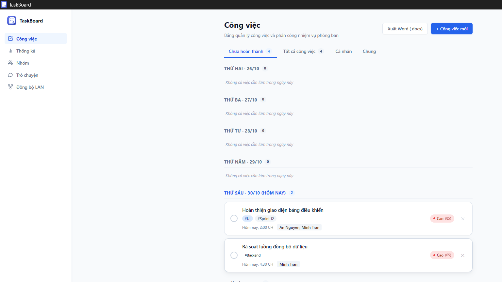

# TaskBoard

TaskBoard is a local-first desktop task manager built with Vue 3, Electron, and Node.js. It helps individuals and small teams organize tasks, track deadlines, and coordinate work across a local network. Task data is stored as files on your device; no external database is required.



## Features

- **Task management:** Set due dates and times, priorities, tags, notes, and one or more assignees. Organize work by deadline and search across task details.
- **Recurring tasks:** Schedule daily, weekly, monthly, or yearly tasks. Completing an occurrence creates the next one while preserving the completed task in history.
- **Team views and statistics:** Review assignments, workload, overdue tasks, and completion progress.
- **Reminders:** Receive desktop notifications and optionally enable recurring alarms for tasks with deadlines.
- **Local-first storage:** Keep tasks and settings in JSON files on the device, with no database service to install.
- **LAN sync:** Share tasks between a host and clients on the same local network. The host stores shared data; clients can also keep a local cache for offline viewing.
- **Google Calendar integration:** Create and update calendar events for tasks with due dates.
- **DOCX export:** Export task lists as formatted Word documents for printing or sharing.
- **Vietnam-time date handling:** Dates and notification schedules use the `Asia/Ho_Chi_Minh` time zone so they remain consistent across devices.

The application interface is currently in Vietnamese. This README and the development documentation are written in English.

## Quick start

### Requirements

- Node.js 18 or newer
- npm

### Install and run

```bash
npm install
npm run dev
```

This starts the Vite development server and opens the Electron application. To run the production-built renderer inside Electron instead, use:

```bash
npm run start
```

## Development

| Command | Description |
| --- | --- |
| `npm run dev` | Start Vite and the development Electron app |
| `npm run dev:test` | Start two isolated Electron instances for LAN testing |
| `npm test` | Run the Vitest test suite |
| `npm run build` | Build the Vue renderer into `dist/` |
| `npm run start` | Build the renderer and launch the production Electron app |
| `npm run dist:win` | Build Windows x64 installer and portable packages in `release/` |

Windows packaging is configured for x64. `npm run dev:test` instructions are in [`devtest/README.md`](./devtest/README.md).

## Project guide

The repository is organized by application layer:

```text
electron/   Electron main process, window lifecycle, and IPC
server/     JSON persistence, LAN sync, calendar integration, and DOCX export
src/        Vue application, views, components, and shared utilities
devtest/    Instructions and configuration for two-instance LAN testing
data/       Local JSON data and first-run seed files
build/      Application icons
```

Tests are colocated with the modules they cover in `server/` and `src/utils/`. For code changes, keep the boundaries between the Electron main process, the preload bridge, and the renderer intact. Run `npm test` after changing application logic and `npm run build` to validate the renderer build.

## LAN sync

LAN sync uses one device as the host and other devices as clients. The host accepts TCP connections on port `22236`; UDP port `22237` is used for host discovery. If network broadcast is blocked, clients can connect using the host's IP address. Configure the local firewall to allow these ports on trusted networks only.

LAN sync is intended for a trusted local network, not the public internet. Chat messages relayed through the host are not end-to-end encrypted.

## Google Calendar setup

Google Calendar sync requires OAuth credentials from your own Google Cloud project:

1. Enable the Google Calendar API in the project.
2. Configure the OAuth consent screen and create a **Desktop app** OAuth client.
3. If the OAuth app is in testing mode, add your Google account as a test user.
4. Enter the client ID and client secret in TaskBoard's settings, save them, and connect your calendar.

Tasks with a due date can then be added to the selected calendar. Disconnect and reconnect if Google reports that the granted permissions are out of date.

## Data and privacy

- During development, JSON data is stored in the project's `data/` directory. Packaged Windows builds use the current user's application data directory, typically `%APPDATA%\TaskBoard\data\`.
- Packaged builds seed a new data directory from the repository's `data/` files. Keep those files free of personal or test data before building a release.
- Google OAuth refresh tokens are stored unencrypted in the local `data/tokens.json` file. Do not share or commit this file. You can revoke TaskBoard's access from your Google Account security settings.
- Task data is local unless you explicitly enable LAN sync or Google Calendar integration.
